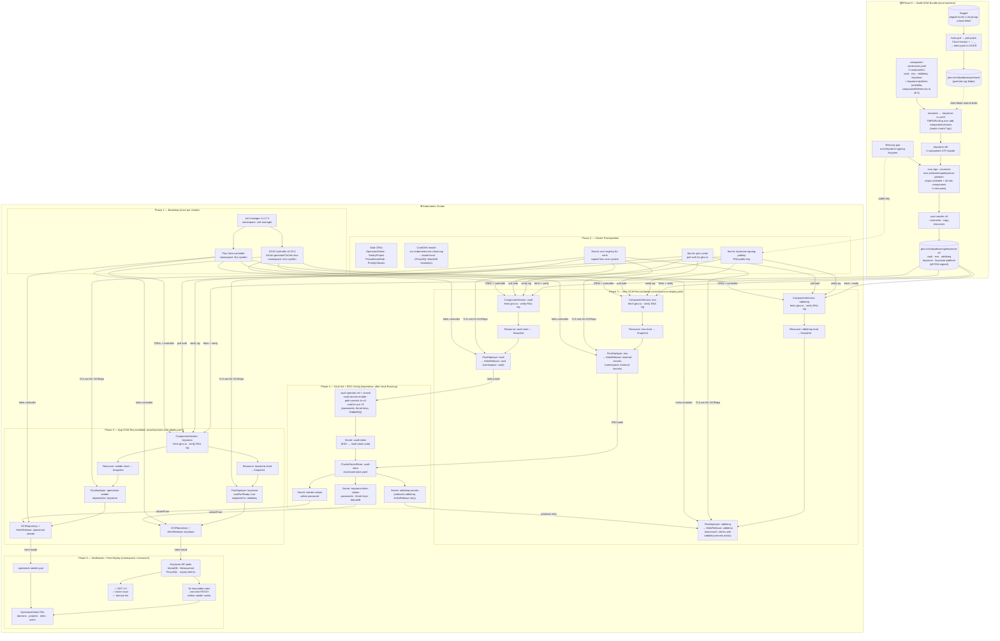

# SAP Keystone Deployment — OCM + Flux

Deploys SAP Keystone (OpenStack Identity Service) to a Kubernetes cluster using the Open Component Model (OCM) for supply-chain-secure artifact delivery and Flux for GitOps reconciliation.

All five components — HashiCorp Vault, External Secrets Operator, RabbitMQ, Keystone, and openstack-seeder — are packaged as a single signed OCM bundle and deployed by Flux via two `kubectl apply` commands.

## Architecture



Secret flow: **Vault → ESO (ExternalSecrets) → K8s Secrets → Flux HelmRelease `valuesFrom`**

Dependency ordering: **vault → eso → rabbitmq** (concurrent) → **keystone** (`dependsOn: rabbitmq`) → **openstack-seeder** (`dependsOn: keystone`)

## Prerequisites

| Tool | Required for |
|------|-------------|
| `ocm` CLI | Build / sign / push OCM bundles |
| `helm` CLI | Pull/push charts (`chart-prepare`), install bootstrap components (cert-manager, OCM controller, Flux) |
| `flux` CLI | Bootstrap Flux on the cluster |
| `kubectl` + kubeconfig | All cluster operations |
| `envsubst` | Variable substitution in component-constructor.yaml |
| `python3` | Vault init parsing, fix-immutable-roles script |
| `GITHUB_TOKEN` env var | Push/pull to ghcr.io (write:packages scope) — export before Phase 0 |

---

## Phase 0 — Prepare the OCM bundle (local, once per version)

These steps run **on your local machine** and produce a signed 5-component bundle in ghcr.io. Re-run when any chart version changes.

```bash
export GITHUB_TOKEN=<your-pat>   # GitHub PAT with write:packages scope
cd sci-keystone
```

### 0a. Prepare charts — pull from Keppel, patch, push to GHCR (one-time per version)

OCM reads charts from local `.tgz` blobs during `ocm add componentversions`. The only pre-step is a one-time `helm pull → patch → helm push` per version to apply the `+`-in-label-value fix (Flux OCI appends `+<digest>` to chart versions; Kubernetes rejects `+` in label values).

```bash
echo $GITHUB_TOKEN | helm registry login ghcr.io --username sofiyadesaisap --password-stdin

# ── vault (hashicorp public repo) ──────────────────────────────────────────
helm repo add hashicorp https://helm.releases.hashicorp.com && helm repo update hashicorp
helm pull hashicorp/vault --version 0.28.1 --destination charts/
helm push charts/vault-0.28.1.tgz oci://ghcr.io/sofiyadesaisap/charts

# ── external-secrets ────────────────────────────────────────────────────────
helm repo add external-secrets https://charts.external-secrets.io && helm repo update external-secrets
helm pull external-secrets/external-secrets --version 0.10.7 --destination charts/
helm push charts/external-secrets-0.10.7.tgz oci://ghcr.io/sofiyadesaisap/charts

# ── rabbitmq (in-tree chart) ─────────────────────────────────────────────────
helm package rabbitmq/chart --version 1.0.0 --destination charts/
helm push charts/rabbitmq-1.0.0.tgz oci://ghcr.io/sofiyadesaisap/charts

# ── keystone — pull from Keppel, patch labels, push ─────────────────────────
helm pull oci://keppel.eu-de-1.cloud.sap/ccloud-helm/keystone \
  --version 0.13.3 --destination charts/
TMPDIR=$(mktemp -d) && \
  tar -xzf charts/keystone-0.13.3.tgz -C $TMPDIR && \
  find $TMPDIR/keystone/templates -name "*.yaml" | xargs perl -pi -e \
    's/\{\{[ ]*\.Chart\.Version[ ]*\}\}/{{ .Chart.Version | replace "+" "_" }}/g;
     s/(printf "%s-%s" \.Chart\.Name \.Chart\.Version)([ ]*)\}\}/$1$2| replace "+" "_" }}/g;
     s/\{\{ \$key \}\}:/"{{ \$key }}":/g' && \
  helm package $TMPDIR/keystone --destination charts/ && rm -rf $TMPDIR
helm push charts/keystone-0.13.3.tgz oci://ghcr.io/sofiyadesaisap/charts

# ── openstack-seeder — pull, patch, push ────────────────────────────────────
helm pull oci://keppel.eu-de-1.cloud.sap/ccloud-helm/openstack-seeder \
  --version 0.1.0 --destination charts/
TMPDIR=$(mktemp -d) && \
  tar -xzf charts/openstack-seeder-0.1.0.tgz -C $TMPDIR && \
  find $TMPDIR/openstack-seeder/templates -name "*.yaml" | xargs perl -pi -e \
    's/\{\{[ ]*\.Chart\.Version[ ]*\}\}/{{ .Chart.Version | replace "+" "_" }}/g;
     s/(printf "%s-%s" \.Chart\.Name \.Chart\.Version)([ ]*)\}\}/$1$2| replace "+" "_" }}/g' && \
  helm package $TMPDIR/openstack-seeder --destination charts/ && rm -rf $TMPDIR
helm push charts/openstack-seeder-0.1.0.tgz oci://ghcr.io/sofiyadesaisap/charts
```

Or: `make chart-prepare`

### 0b. Generate RSA signing key pair (one-time)

- **Local machine**: `ocm sign --signer cosign` opens a browser OIDC flow (GitHub, Google, Microsoft)
- **GitHub Actions**: uses the workflow's OIDC token automatically — no secret needed

> **Never commit `ocm/keystone-signing-key.pem`** — it is gitignored. The public key is committed and pushed to the cluster as a Secret.

### 0c. Build the OCM CTF (Component Transfer Format)

Builds a 5-component bundle: vault, eso, rabbitmq, keystone (+ seeder-chart resource), and the `keystone-platform` umbrella that references all four.

```bash
export KEYSTONE_VERSION=0.13.3
export SEEDER_VERSION=0.1.0
export VAULT_VERSION=0.28.1
export ESO_VERSION=0.10.7
export RABBITMQ_VERSION=1.0.0
export PLATFORM_VERSION=1.0.0
export GITHUB_USER=sofiyadesaisap

rm -rf keystone-ctf
envsubst < component-constructor.yaml > .keystone-cc.yaml
TMPDIR=/tmp ocm add componentversions --file keystone-ctf --create .keystone-cc.yaml
rm .keystone-cc.yaml
```

Or: `make ocm-build`

### 0d. Sign all components

`--recursive` follows `componentReferences` in the umbrella and signs every sub-component in one pass using `jsonNormalisation/v3`.

```bash
# Local machine: opens browser OIDC flow (GitHub / Google / Microsoft account)
# GitHub Actions: uses the workflow OIDC token automatically — no secrets needed
ocm sign componentversions \
  --repo ctf::keystone-ctf \
  --signature keystone-sig \
  --private-key ocm/keystone-signing-key.pem \
  --recursive \
  ocm.software/sap/keystone-platform
```

Or: `make ocm-sign`

> Signing identity and timestamp are recorded in the public Rekor log. No private key file required. `verify:` blocks are intentionally absent from all `ComponentVersion` CRs — the OCM controller fetches and deploys without cluster-side verification (air-gated compatible).

### 0e. Push the signed bundle to ghcr.io

```bash
ocm \
  --cred :type=OCIRegistry --cred :hostname=ghcr.io \
  --cred username=sofiyadesaisap --cred password=$GITHUB_TOKEN \
  transfer ctf \
  --overwrite \
  --copy-resources \
  keystone-ctf \
  oci://ghcr.io/sofiyadesaisap/keystone-ctf
```

Or: `make ocm-push`

Verify:

```bash
ocm get componentversion --repo oci://ghcr.io/sofiyadesaisap/keystone-ctf \
  ocm.software/sap/keystone-platform
```

**Shorthand for 0c–0e:** `make ocm-fresh-push`

---

## Phase 1 — Bootstrap the cluster (once per new cluster)

```bash
export KUBECONFIG=../kubeconfig-for-shoot.yaml
```

### 1a. Create namespaces and label nodes

```bash
kubectl create namespace monsoon3 --dry-run=client -o yaml | kubectl apply -f -
kubectl create namespace vault --dry-run=client -o yaml | kubectl apply -f -
kubectl create namespace external-secrets --dry-run=client -o yaml | kubectl apply -f -
kubectl label nodes --all openstack-control-plane=enabled --overwrite
```

Or: `make setup`

### 1b. Install cert-manager

Required by the OCM controller (uses cert-manager for its webhook TLS).

```bash
helm repo add jetstack https://charts.jetstack.io && helm repo update
helm upgrade --install cert-manager jetstack/cert-manager \
  --namespace cert-manager --create-namespace \
  --set installCRDs=true \
  --version v1.17.2 \
  --wait
```

Or: `make cert-manager-install`

### 1c. Install OCM controller

> `--set tlsCert.generateTlsCert=true` is **mandatory**. Without it the `ocm-registry-tls-certs` Secret is never created and every FluxDeployer OCIRepository pull will fail.

```bash
helm upgrade --install ocm-controller \
  oci://ghcr.io/open-component-model/helm/ocm-controller \
  --version v0.33.0 \
  --namespace ocm-system --create-namespace \
  --set tlsCert.generateTlsCert=true \
  --wait
```

Or: `make ocm-controller-install`

### 1d. Install Flux

```bash
TMPDIR=/tmp flux install --namespace flux-system
```

Or: `make flux-install`

Verify all three healthy: `make bootstrap-status`

**Shorthand for 1a–1d:** `make bootstrap`

---

## Phase 2 — Cluster prerequisites (one-time per cluster)

### 2a. Apply stub CRDs and PriorityClasses

The keystone chart references these types; stubs let Helm install without the real controllers.

```bash
kubectl apply -f crds/priority-classes.yaml
kubectl apply -f crds/openstackseed-crd.yaml
kubectl apply -f crds/stub-sentryproject-crd.yaml
kubectl apply -f crds/stub-prometheusrule-crd.yaml
```

Or: `make crds-apply`

### 2b. Patch CoreDNS for SAP DNS names

ProxySQL resolves MariaDB as `keystone-mariadb.monsoon3.svc.kubernetes.test.cloud.sap`. Gardener clusters use `cluster.local`. This patch rewrites both the query and the answer (glibc discards answers where the answer name does not match the question name — `nslookup` alone is not sufficient to verify this).

```bash
kubectl patch configmap coredns-custom -n kube-system --type merge -p \
  '{"data":{"sap-dns.override":"rewrite stop {\n  name regex (.+)\\.svc\\.kubernetes\\.test\\.cloud\\.sap {1}.svc.cluster.local\n  answer name (.+)\\.svc\\.cluster\\.local {1}.svc.kubernetes.test.cloud.sap\n}\n"}}'
kubectl rollout restart deployment coredns -n kube-system
kubectl rollout status deployment coredns -n kube-system --timeout=180s
```

Or: `make coredns-rewrite`

### 2c. Create cluster secrets (OCM pull auth + signature verification)

```bash
# GHCR pull secret — OCM controller uses this to fetch components
kubectl create secret docker-registry ghcr-creds \
  --docker-server=ghcr.io \
  --docker-username=sofiyadesaisap \
  --docker-password=$GITHUB_TOKEN \
  --namespace monsoon3 \
  --dry-run=client -o yaml | kubectl apply -f -

# RSA public key — ComponentVersion CRs use this to verify signatures
kubectl create secret generic keystone-signing-pubkey \
  --from-file=keystone-sig=ocm/keystone-signing-key-pub.pem \
  --namespace monsoon3 \
  --dry-run=client -o yaml | kubectl apply -f -

# OCM registry TLS cert — FluxDeployer auto-sets certSecretRef on OCIRepositories
# pointing to this secret; pull fails if it doesn't exist in the target namespace
kubectl get secret ocm-registry-tls-certs -n ocm-system -o json | \
  python3 -c "import sys,json; d=json.load(sys.stdin); \
    d['metadata']={'name':d['metadata']['name'],'namespace':'monsoon3'}; \
    print(json.dumps(d))" | kubectl apply -f -
```

Or: `make ghcr-secret ocm-signing-secret ocm-tls-cert-secret`

---

## Phase 3 — Deploy all components via OCM

Two YAML files start the entire reconciliation chain. Vault, ESO, RabbitMQ, Keystone, and the seeder all begin deploying concurrently (ordering is enforced by Flux `dependsOn` and the ESO secret-sync prerequisite for RabbitMQ).

```bash
# Infrastructure: Vault + ESO + RabbitMQ
kubectl apply -f ocm/infra-ocm-deploy.yaml

# Application: Keystone + openstack-seeder
kubectl apply -f ocm/keystone-ocm-deploy.yaml
```

Or: `make ocm-deploy`

Each file contains three Kubernetes CRs per component: `ComponentVersion` (fetch + verify), `Resource` (extract chart as Snapshot), and `FluxDeployer` (create OCIRepository + HelmRelease).

Watch the OCM reconciliation start:

```bash
kubectl get componentversion,fluxdeployer,helmrelease -n monsoon3 -w
```

---

## Phase 4 — Vault initialization (after vault pod Running)

These steps are inherently imperative — you cannot declaratively generate unseal keys.

```bash
# Wait for vault pod (not Ready — sealed vaults never pass the readiness probe)
kubectl wait pod/vault-0 -n vault \
  --for=jsonpath='{.status.phase}'=Running --timeout=300s

# Initialize — saves unseal key + root token to vault/vault-init.json (gitignored)
kubectl exec vault-0 -n vault -- \
  vault operator init -key-shares=1 -key-threshold=1 -format=json > vault/vault-init.json

# Unseal
UNSEAL_KEY=$(python3 -c "import json; \
  print(json.load(open('vault/vault-init.json'))['unseal_keys_b64'][0])")
kubectl exec vault-0 -n vault -- vault operator unseal $UNSEAL_KEY

# Enable KV v2 at mount 'secrets' (mirrors SAP production: secrets/<region>/...)
ROOT_TOKEN=$(python3 -c "import json; \
  print(json.load(open('vault/vault-init.json'))['root_token'])")
kubectl exec vault-0 -n vault -- \
  env VAULT_TOKEN=$ROOT_TOKEN vault secrets enable -path=secrets kv-v2
```

Or: `make vault-init vault-unseal vault-enable-kv`

### Populate secrets

```bash
make vault-populate   # generates secure random passwords and writes all 9 paths
```

All paths follow the SAP production structure (`secrets/<region>/keystone/...`), using `test` as the region:

| Vault path | Field(s) |
|---|---|
| `secrets/test/keystone/keystone-user/admin` | `password` |
| `secrets/test/keystone/mariadb-user/keystone` | `password` |
| `secrets/test/keystone/mariadb-user/root` | `password` |
| `secrets/test/keystone/mariadb-user/backup` | `user`, `password` |
| `secrets/test/keystone/mariadb-user/metis` | `username`, `password` |
| `secrets/test/keystone/keystone-fernet-secrets/default` | `0`, `1`, `2` |
| `secrets/test/keystone/keystone-credentials-secrets/default` | `0`, `1` |
| `secrets/test/hermes/rabbitmq-user/notifications-keystone` | `username`, `password` |
| `secrets/test/shared/radius-auth/default` | `secret` |

### Create vault-token Secret for ESO

```bash
ROOT_TOKEN=$(python3 -c "import json; \
  print(json.load(open('vault/vault-init.json'))['root_token'])")
kubectl create secret generic vault-token \
  --from-literal=token="$ROOT_TOKEN" \
  --namespace vault \
  --dry-run=client -o yaml | kubectl apply -f -
```

Or: `make vault-token-secret`

---

## Phase 5 — ESO configuration

```bash
# Wait for ESO webhook (required before ClusterSecretStore can be admitted)
kubectl rollout status deployment/external-secrets-webhook \
  -n external-secrets --timeout=120s

# Connect ESO to Vault
kubectl apply -f eso/clusterstore.yaml

# Declare what secrets to sync — creates keystone-helm-values, seeder-values, rabbitmq-secrets
kubectl apply -f eso/externalsecrets.yaml

# Verify sync (~30 seconds)
kubectl get externalsecret -n monsoon3
```

Or: `make eso-apply-clusterstore eso-apply-externalsecrets`

Once `keystone-helm-values` and `rabbitmq-secrets` show `SecretSynced`, Flux automatically retries the RabbitMQ, Keystone, and seeder HelmReleases — no manual intervention needed.

---

## Phase 6 — Watch the reconciliation chain

```bash
kubectl get helmrelease -n monsoon3 -w
```

Expected final state:

```
NAME               READY   STATUS
vault              True    Release reconciliation succeeded
external-secrets   True    Release reconciliation succeeded
rabbitmq           True    Release reconciliation succeeded
keystone           True    Release reconciliation succeeded
openstack-seeder   True    Release reconciliation succeeded
```

Full status including OCM objects: `make ocm-status`

If a HelmRelease gets stuck:

```bash
kubectl describe helmrelease keystone -n monsoon3
kubectl logs -n flux-system -l app=helm-controller --tail=50
make ocm-fresh-install   # clears Helm history + restarts helm-controller + re-applies
```

---

## Phase 7 — Post-deploy: fix immutable roles and verify

### 7a. Fix immutable bootstrap roles (run once)

Keystone's `epoxy` release marks built-in roles (`admin`, `member`, `reader`, `service`, `manager`) as immutable on first boot. The openstack-seeder gets HTTP 403 trying to update descriptions without this fix.

```bash
# Port-forward in a separate terminal first
kubectl port-forward svc/keystone -n monsoon3 5000:5000 &

ADMIN_PASS=$(kubectl get secret keystone-helm-values -n monsoon3 \
  -o jsonpath='{.data.values\.yaml}' | base64 -d | \
  grep 'adminPassword:' | awk '{print $2}' | tr -d '"')

TOKEN=$(curl -sf \
  -H 'Content-Type: application/json' \
  -d "{\"auth\":{\"identity\":{\"methods\":[\"password\"],\"password\":{\"user\":{\"name\":\"admin\",\"domain\":{\"id\":\"default\"},\"password\":\"$ADMIN_PASS\"}}},\"scope\":{\"project\":{\"name\":\"admin\",\"domain\":{\"id\":\"default\"}}}}}" \
  -D /tmp/ks-headers.txt \
  http://localhost:5000/v3/auth/tokens > /dev/null && \
  grep -i '^x-subject-token' /tmp/ks-headers.txt | awk '{print $2}' | tr -d '\r\n')

curl -s http://localhost:5000/v3/roles -H "X-Auth-Token: $TOKEN" | \
TOKEN="$TOKEN" python3 -c \
  "import json,sys,os,urllib.request as U; t=os.environ['TOKEN']; \
  [(print('unsetting: '+r['name']),U.urlopen(U.Request( \
    'http://localhost:5000/v3/roles/'+r['id'], \
    data=b'{\"role\":{\"options\":{\"immutable\":false}}}', \
    headers={'X-Auth-Token':t,'Content-Type':'application/json'}, \
    method='PATCH'))) \
  for r in json.load(sys.stdin).get('roles',[]) if r.get('options',{}).get('immutable')]"
```

Or: `make fix-immutable-roles` (requires `make keystone-port-forward` in another terminal)

### 7b. Verify Keystone is serving

```bash
# Version endpoint
curl -s http://localhost:5000/v3 | python3 -m json.tool | grep '"status"'
# Expected: "status": "stable"

# List domains (uses token from 7a)
curl -s http://localhost:5000/v3/domains \
  -H "X-Auth-Token: $TOKEN" | python3 -m json.tool | grep '"name"'
```

Or: `make keystone-verify`

---

## Quick reference — full make sequence

```bash
export GITHUB_TOKEN=<your-pat>
export KUBECONFIG=../kubeconfig-for-shoot.yaml
cd sci-keystone-deployment

# ── Local: chart preparation (one-time per version) ──────────────────────────
make chart-prepare           # helm pull Keppel/hashicorp → patch → helm push GHCR

# ── Local: OCM bundle (re-run per version) ───────────────────────────────────
make ocm-fresh-push          # build CTF (5 components) + sign --recursive + push to GHCR

# ── Cluster bootstrap (once per cluster) ─────────────────────────────────────
make bootstrap               # namespaces + cert-manager + OCM controller + Flux

# ── Cluster prerequisites ─────────────────────────────────────────────────────
make crds-apply              # stub CRDs + PriorityClasses
make coredns-rewrite         # SAP DNS → cluster.local rewrite
make ghcr-secret ocm-signing-secret ocm-tls-cert-secret

# ── Deploy all components (Vault + ESO + RabbitMQ + Keystone + Seeder) ────────
make ocm-deploy              # kubectl apply infra + keystone OCM manifests

# ── Vault init (after vault pod Running) ──────────────────────────────────────
make vault-init vault-unseal vault-enable-kv vault-populate vault-token-secret

# ── ESO config (after ESO pod Running) ───────────────────────────────────────
make eso-apply-clusterstore eso-apply-externalsecrets

# ── Watch all HelmReleases converge (~15–25 min) ──────────────────────────────
make ocm-status

# ── Verify (in a separate terminal: make keystone-port-forward) ───────────────
make fix-immutable-roles
make keystone-verify
```

---

## Dependency order

```
Keppel ──→ helm pull → patch → helm push ──→ ghcr.io/sofiyadesaisap/charts  (one-time per version)
                                                          │
                                          ocm add componentversions (reads charts/ blobs)
                                          ocm sign --recursive keystone-platform
                                          ocm transfer ctf ──────────────────────→ ghcr.io/sofiyadesaisap/keystone-ctf
                                                                                            │
cert-manager ──→ OCM controller ──→ Flux                                      (bootstrap — OCM needs cert-manager for TLS)
                                                                                            │
                               kubectl apply ocm/infra-ocm-deploy.yaml ◄──────────────────┤
                                   │                                                        │
                    ┌──────────────┼──────────────┐                                        │
                  vault           eso           rabbitmq  (OCM: fetch+verify+HelmRelease)  │
                    │              │                │                                        │
              vault-init      ESO pods      waits for rabbitmq-secrets                     │
                    │              │                │                                        │
              vault-token    ClusterSecretStore     │                                        │
                    │              │                │                                        │
              ExternalSecrets → keystone-helm-values, seeder-values, rabbitmq-secrets ──→ unblocks rabbitmq
                                                                                            │
                               kubectl apply ocm/keystone-ocm-deploy.yaml ◄────────────────┘
                                   │
                          ComponentVersion: keystone (verify sig)
                                   │
                    ┌──────────────┴──────────────┐
              keystone-chart                  seeder-chart
              (dependsOn: rabbitmq)           (dependsOn: keystone)
                    │                              │
              HelmRelease: keystone          HelmRelease: openstack-seeder
                    │
              fix-immutable-roles ──→ seeder seeds domains/projects/roles
```

---

## Files

| File | Purpose |
|------|---------|
| `component-constructor.yaml` | OCM bundle definition — 5 components (vault, eso, rabbitmq, keystone+seeder, keystone-platform umbrella) |
| `Makefile.scikeystone` | All deployment targets |
| `ocm/infra-ocm-deploy.yaml` | ComponentVersion + Resource + FluxDeployer for vault, eso, rabbitmq |
| `ocm/keystone-ocm-deploy.yaml` | ComponentVersion + Resource (×2) + FluxDeployer (×2) for keystone + seeder |
| `ocm/keystone-signing-key-pub.pem` | RSA public key (committed); private key is gitignored |
| `eso/clusterstore.yaml` | ESO ClusterSecretStore — Vault token auth backend |
| `eso/externalsecrets.yaml` | ExternalSecrets for keystone-helm-values, seeder-values, rabbitmq-secrets |
| `crds/` | Stub CRDs for OpenstackSeed, SentryProject, PrometheusRule + PriorityClasses |
| `rabbitmq/` | Minimal in-tree RabbitMQ Helm chart (replaces SAP Hermes) |
| `charts/` | Local chart blobs — gitignored, regenerated by `make chart-prepare` |
| `vault/vault-init.json` | Vault unseal keys + root token — **gitignored, never commit** |

## Security notes

- `vault/vault-init.json` — Vault unseal keys + root token — **gitignored, never commit**
- `GITHUB_TOKEN` — must be set as an environment variable, never committed
- No credentials exist in Git; all secrets flow from Vault → ESO → K8s Secrets → `valuesFrom`
